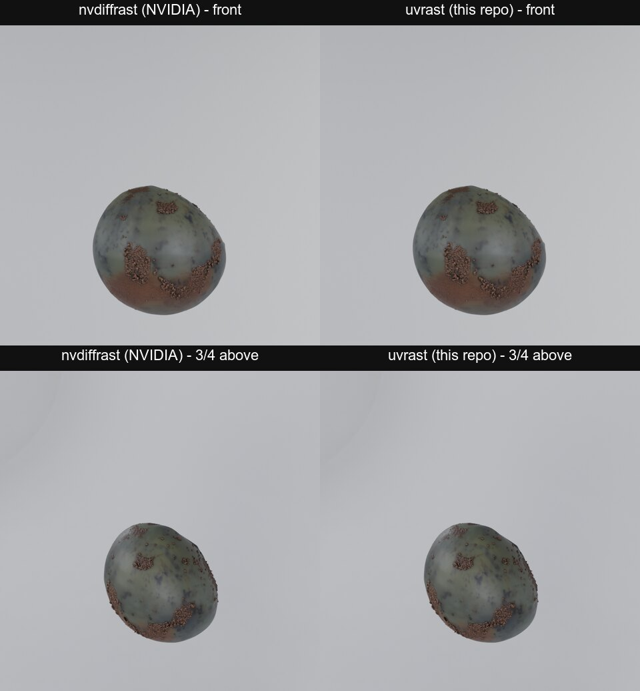

# uvrast

A clean-room replacement for the two nvdiffrast calls in the GLB texture bake of TRELLIS.2
(`o_voxel.postprocess.to_glb`). nvdiffrast's licence allows "research or evaluation purposes" only, so a commercial
pipeline cannot use it.



The same TRELLIS.2 mesh, baked with nvdiffrast (left) and with uvrast (right), then rendered in Blender. This is the
worst case of the test: of 197 million baked texels, 4 differ, and the render difference is smaller than the
renderer's own noise. 14 of 17 test GLBs are byte-identical. The claim covers the forward bake only (no gradients).
How it was compared, the scope of the claim, a fur example and all numbers: [docs/COMPARISON.md](docs/COMPARISON.md).

uvrast gives the same three names as `nvdiffrast.torch`:

- `RasterizeCudaContext(device=None)`: no state; kept for the API.
- `rasterize(ctx, pos, tri, resolution)`: returns `(rast, db)`. `rast` is `[minibatch, H, W, 4]` float32 with
  `(u, v, z/w, triangle_id + 1)` per pixel, all zero where no triangle covers the pixel centre. `db` has 0 channels
  (to_glb does not use it).
- `interpolate(attr, rast, tri)`: returns `(out, empty)`. `out` is the attribute at each pixel, zero where empty.

Only what to_glb uses is supported: a UV layout (z = 0, w = 1 for every vertex), instanced mode, no antialiasing,
no texture sampling, no gradients, no image-space derivatives. Other input raises an error, so a caller never gets
a silently different result.

## Use

```python
import sys; sys.path.insert(0, "/path/to/uvrast")
import uvrast; uvrast.install()   # before o_voxel is imported: sys.modules["nvdiffrast.torch"] = uvrast
import o_voxel                   # to_glb now bakes with uvrast
```

It needs only PyTorch. It runs on CUDA, on the CPU and on Apple MPS.

## Behaviour (found by black-box probes; see "Clean-room record")

- Pixel centres at (i + 0.5) / n in [0, 1]; row 0 is the bottom (v near 0).
- Coverage: vertex positions snapped to 1/16 pixel (round half to even); exact integer edge test; a centre exactly on
  an edge belongs to the triangle when the edge is a "top-left" edge (for a counter-clockwise triangle in row-up
  coordinates: the edge goes down, or it is horizontal and goes right). Both windings are drawn; zero-area triangles
  (after snapping) are not.
- Above 2048 pixels the grid is handled in 2048-pixel sub-grids: a triangle that crosses a sub-grid border (or the
  grid border) is clipped there, and the new vertices are snapped to 1/16 pixel.
- Equal depth (always, in a UV layout): the triangle with the higher index in the call wins.
- Barycentrics come from the UNSNAPPED positions: each vertex relative to the pixel centre, e_i = cross product of
  the other two vertices (one fused multiply-add), u = e0 * (1 / (e0 + e1 + e2)), v likewise; u and v are clamped to
  [0, 1] and scaled by 1 / (u + v) when u + v > 1.
- interpolate: w = (1 - u) - v; out = fma(w, a2, fma(u, a0, v * a1)).
- uvrast does the fused multiply-adds in float64 with an exact correction, so the float32 result is correctly rounded
  on every device (`rules.fma32`, tested against exact rational arithmetic).

## Method

1. Each vertex position is changed to a fixed-point integer position (see `uvrast/rules.py`). Triangles that cross a
   sub-grid border are clipped and fan-triangulated first.
2. Each triangle's bounding box of pixel centres is expanded to (triangle, pixel) candidates. Large boxes are split
   into row bands, and the candidates are processed in passes with a fixed memory limit.
3. Each candidate gets an exact integer inside test (edge functions on the fixed-point positions, with a fill rule
   for a centre that is exactly on an edge).
4. One `scatter_reduce` per pass picks the winner per pixel (all triangles have the same depth in a UV layout).
5. The barycentrics are calculated only for the winners.

## Files

- `uvrast/__init__.py`: the public API and `install()`.
- `uvrast/raster.py`: the rasterizer and the interpolation.
- `uvrast/rules.py`: the conventions that decide coverage and the exact float32 values.
- `tests/`: self-contained tests (no nvdiffrast): `python -m pytest tests`.
- `tools/cases.py`: synthetic test shapes (degenerate, slivers, vertices on texel centres, shared edges along rows,
  columns and diagonals, UVs at 0 and 1, large triangles).
- `tools/probe_nvdiffrast.py`, `tools/check_probe.py`: black-box probes of nvdiffrast and their comparison.
- `tools/bake_compare.py`: the equality test on real TRELLIS.2 meshes.
- `docs/COMPARISON.md`, `docs/comparison/`: how uvrast was compared with nvdiffrast, the results and the images.

## Clean-room record

Rule: nobody working on this repository opened, read, searched or copied the source code of nvdiffrast (or
nvdiffrec) in any form: not on GitHub, not in an installed package, not in a PyPI sdist or wheel.

What was read:
- nvdiffrast's public documentation (https://nvlabs.github.io/nvdiffrast/): function signatures, argument shapes and
  dtypes, the output layout `(u, v, z/w, triangle_id)`, "pixels where no triangle was rasterized will receive a zero
  in all channels", the barycentric convention (first vertex (1, 0), second (0, 1), third (0, 0)), and "row 0 ... is
  the bottom row".
- TRELLIS.2's own code that calls nvdiffrast (`o-voxel/o_voxel/postprocess.py`, MIT), to know which calls and
  arguments are used.

How the behaviour was found: black-box runs of nvdiffrast through its Python API in an evaluation environment
(the licence allows evaluation), with test triangles (`tools/probe_nvdiffrast.py`): pixel-centre positions, row
order, the position precision (edges moved across a pixel centre in small steps), the rule for a pixel centre
exactly on an edge, the tie between triangles at the same depth, degenerate triangles, and the float32 arithmetic of
the barycentrics and of `interpolate`. The recorded outputs are evaluation data and are not in this repository.

## Proof of equality

Summary: 25.7M probe texels bit-identical; 51 real bakes (197M texels) with 4 differing texels; 3D positions
bit-identical; 14 of 17 GLBs byte-identical; render differences under the renderer's own noise. Method, full table,
the cause of the 4 texels, images and how to reproduce: [docs/COMPARISON.md](docs/COMPARISON.md).

## Speed (same inputs, 4096, 3 repeats, minimum)

nvdiffrast rasterize + interpolate: 18.3 to 19.4 ms (36.5 ms at 995k faces). uvrast: 131 to 185 ms. In a production TRELLIS.2
pipeline, uvrast's share is 124 to 292 ms per prop, 0.2 to 0.7% of the GLB export and 0.05 to 0.3%
of the per-prop time (median 179 s). nvdiffrast's share in the same place was 11 to 33 ms (0.02 to 0.09% of the GLB
export). Rust or a CUDA kernel cannot make the pipeline meaningfully faster: removing the rasterizer completely would
save at most 0.3 s of 48 to 278 s per prop.

## Licence

MIT (`LICENSE`). `tools/bake_compare.py` contains code copied from TRELLIS.2 (MIT, Copyright (c) Microsoft
Corporation); its licence is at the top of that file.
