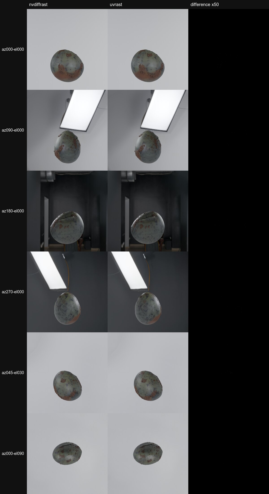

# How uvrast was compared with nvdiffrast

The question: does a TRELLIS.2 GLB baked with uvrast equal the same GLB baked with nvdiffrast? nvdiffrast's licence
allows evaluation, so nvdiffrast ran only as a black box in a separate evaluation environment
(2026-10-31, RTX 3090 Ti, nvdiffrast v0.4.0). Its source was never read (see "Clean-room record" in the README).

## What was compared, in three levels

1. **Synthetic probes** (`tools/probe_nvdiffrast.py`, `probe_big.py`, `probe_axis.py`; checked with `check_probe.py`):
   test triangles at 1024, 2048 and 4096: degenerate and sliver triangles, vertices on texel centres and corners,
   vertices on 1/16, 1/256 and 1/4096 pixel grids, shared edges along rows, columns and diagonals, fans around a
   centre, UVs at 0 and 1 and past them, triangles up to 4000 pixels, and 110,905 triangles in one call (chunk
   offsets). Compared: triangle id, u, v and interpolated values on every texel.
2. **Real bakes** (`tools/bake_compare.py`, run per mesh by `tools/compare_all.sh`, summed by
   `tools/summarize_compare.py`): TRELLIS.2 meshes (1024_cascade, seed 42, the to_glb settings of a production
   pipeline). Each mesh is unwrapped ONCE, so both bakes get the same UV mesh; then it is baked with nvdiffrast and with
   uvrast at 1024, 2048 and 4096. Compared: coverage, triangle id, 3D position per texel, the four final texture maps
   after to_glb's seam fill, and the GLB files.
3. **Renders** (`tools/render_compare.py`): the GLB with the largest difference, rendered in Blender (Cycles) from 34
   views with both bakes. Control: the same GLB rendered twice, to measure the renderer's own noise.

## Results

Probes: 25.7M covered texels, bit-identical on every texel (triangle ids, u, v, interpolated values). nvdiffrast was
deterministic in every repeat.

Real bakes: 16 generated props and one mesh of 994,974 faces, 51 bakes, 197,438,896 covered texels.

| measure | result |
|---|---|
| triangle id and coverage | 4 texels differ, all at 4096 (one each in 4 props) |
| 3D position on matching texels | bit-identical on every texel (max difference 0) |
| four final maps (after inpaint) | 47 of 51 bakes identical; 5 texels over 1/255 in 2 bakes (4 and 1); lowest PSNR 106.9 dB |
| GLB files at 4096 | byte-identical for 14 of 17 meshes, including all 6 pipeline props |
| Blender renders, 34 views (the prop with the largest difference) | min PSNR 77.5 dB; control (the same GLB rendered twice): 77.2 dB, so the difference is under Cycles' own noise |

Quality scores of the 6 pipeline props were not run twice: their two GLBs are byte-identical, and the same input
bytes give the same score.

### The 4 differing texels

A triangle crosses the 2048-pixel border, and the exact position of the new clip vertex is within 0.001 of 1/32 pixel
from a rounding midpoint (in one prop: 5237.499 sixteenths of a pixel). nvdiffrast computes it in float32 and rounds
the other way; uvrast computes it exactly. To remove them, the float32 clip arithmetic must be found with a targeted
probe (not done). OpenCV's Telea inpaint (to_glb's seam fill) fills only uncovered texels, so a coverage difference
also changes the fill near it: 3 to 4 raw texels became 2 to 35 final texels.

## Renders: the worst case

The prop with the most differing texels (a basilisk egg), 6 of the 34 views. Columns: nvdiffrast bake, uvrast bake,
and their per-pixel difference amplified 50 times (a difference of 2% or more shows as white). The largest pixel
difference in these 6 views is 1 of 255, the size of the renderer's own noise.



The README's 2x2 image (`comparison/hero-2x2.jpg`) shows two of these views at a larger size.

## Reproduce

Needs a TRELLIS.2 environment with nvdiffrast for the evaluation side, and decoded meshes saved by a TRELLIS.2
runner.

```bash
PYTHON=/path/to/evaluation-venv/bin/python bash tools/compare_all.sh MESH_DIR OUT_DIR prop[:decimation] ...
python tools/summarize_compare.py OUT_DIR
python tools/render_compare.py RENDERS_NVDIFFRAST RENDERS_UVRAST
```

The recorded nvdiffrast outputs (probe data, bakes) are evaluation data and are not in this repository; the two
images above are renders of the comparison result.
